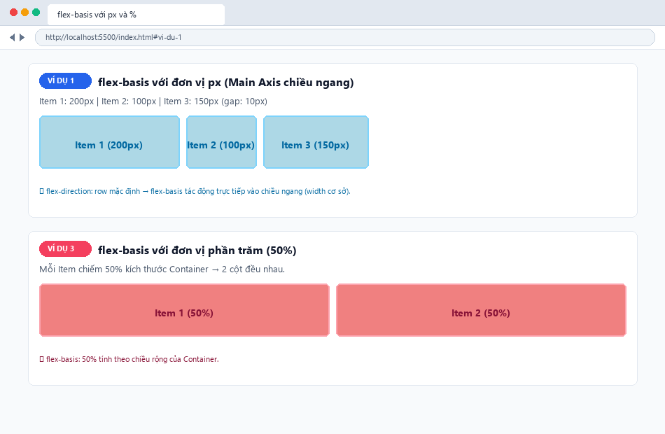
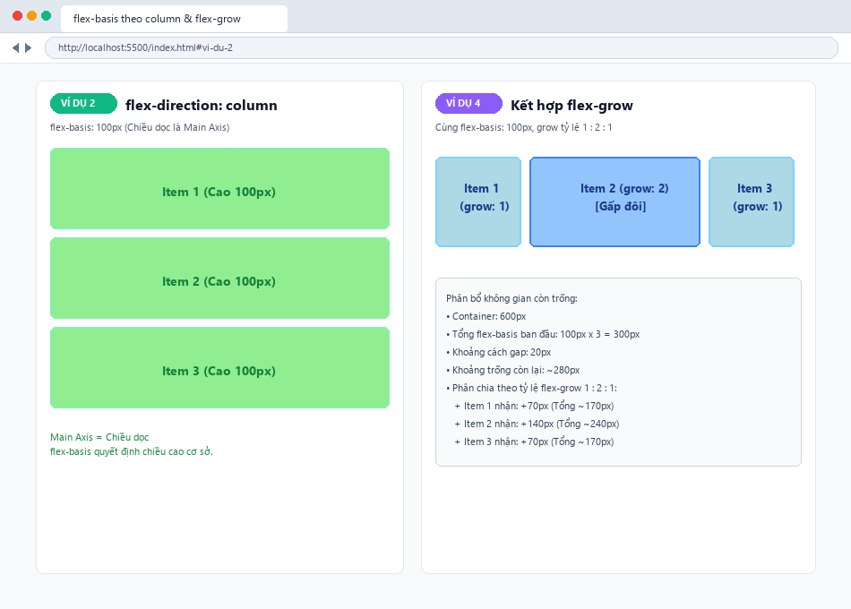
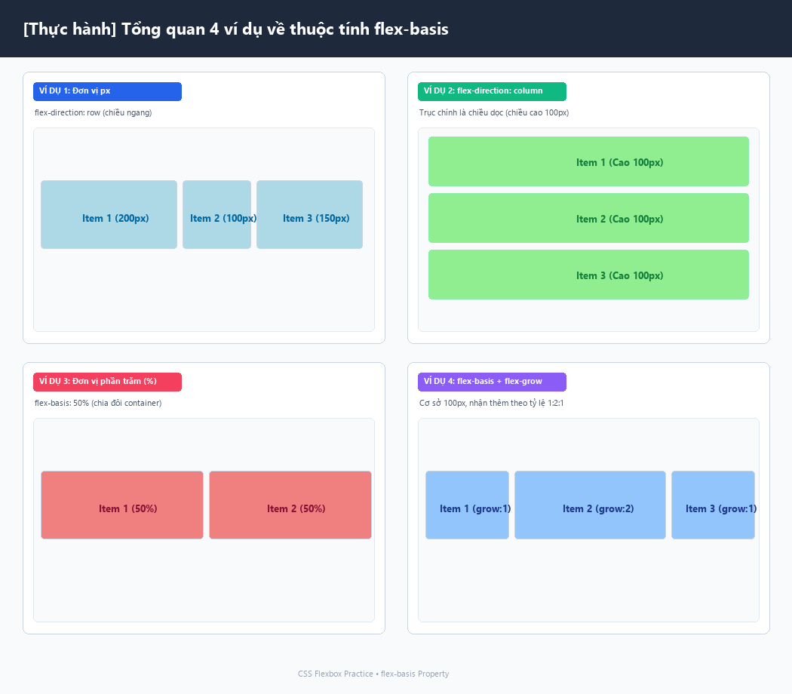

# [Thực hành] CSS | flex-basis Property

Bài thực hành tìm hiểu và áp dụng thuộc tính `flex-basis` trong **CSS Flexbox** nhằm xác định kích thước cơ sở ban đầu của Flex Item trên trục chính (Main Axis).

---

## 📖 1. Khái niệm & Cú pháp

Thuộc tính `flex-basis` xác định kích thước cơ sở ban đầu của một Flex Item trước khi không gian trống còn lại trong Flex Container được phân bổ bởi `flex-grow` hoặc co lại bởi `flex-shrink`.

### Cú pháp:
```css
flex-basis: <length> | <percentage> | auto | initial | inherit;
```

### 💡 Lưu ý quan trọng về Trục chính (Main Axis):
Kích thước mà `flex-basis` tác động phụ thuộc vào `flex-direction`:
- `flex-direction: row` (mặc định) &rarr; Trục chính là **chiều ngang** &rarr; `flex-basis` tác động như **chiều rộng (width)** ban đầu.
- `flex-direction: column` &rarr; Trục chính là **chiều dọc** &rarr; `flex-basis` tác động như **chiều cao (height)** ban đầu.

---

## 🛠️ 2. Chi tiết 4 ví dụ thực hành

### Ví dụ 1: Sử dụng flex-basis với đơn vị độ dài (px)
- **Mã nguồn:** `.item1 { flex-basis: 200px; } .item2 { flex-basis: 100px; } .item3 { flex-basis: 150px; }`
- **Ý nghĩa:** Trục chính nằm ngang, các item có độ rộng cơ sở lần lượt là 200px, 100px và 150px.

### Ví dụ 2: flex-basis thay đổi theo flex-direction: column
- **Mã nguồn:** `.container { flex-direction: column; } .item { flex-basis: 100px; }`
- **Ý nghĩa:** Khi trục chính chuyển thành chiều dọc, `flex-basis: 100px` quyết định **chiều cao cơ sở** của từng Flex Item.

### Ví dụ 3: Sử dụng flex-basis với đơn vị phần trăm (%)
- **Mã nguồn:** `.item { flex-basis: 50%; box-sizing: border-box; }`
- **Ý nghĩa:** Mỗi item chiếm 50% kích thước trục chính của container, tạo thành bố cục chia đôi cân đối.

### Ví dụ 4: Kết hợp flex-basis với flex-grow
- **Mã nguồn:**
  - Cả 3 item đều có `flex-basis: 100px;` (tổng kích thước cơ sở ban đầu = 300px).
  - Container rộng `600px`.
  - Phân chia khoảng trống theo `flex-grow` tỷ lệ **1 : 2 : 1**: Item 2 nhận gấp đôi khoảng trống so với Item 1 và Item 3.

---

## 📸 3. Ảnh chụp kết quả trên trình duyệt

### 1. Kết quả Ví dụ 1 (px) và Ví dụ 3 (%):


### 2. Kết quả Ví dụ 2 (column) và Ví dụ 4 (flex-grow):


### 3. Tổng quan cả 4 ví dụ:


---

## 📁 4. Cấu trúc thư mục dự án

```text
css-flex-basis/
├── index.html                    # Giao diện tổng hợp đầy đủ 4 ví dụ và bảng so sánh
├── style.css                     # Định kiểu CSS Flexbox cho 4 trường hợp
├── screenshot_px_percent.png     # Ảnh chụp kết quả Ví dụ 1 và 3
├── screenshot_column_grow.png    # Ảnh chụp kết quả Ví dụ 2 và 4
├── tat_ca_vi_du.png              # Ảnh chụp tổng quan cả 4 ví dụ
└── README.md                     # Tài liệu thuyết minh chi tiết
```

---

## 🚀 5. Hướng dẫn kiểm tra trên trình duyệt
1. Mở file `index.html` bằng trình duyệt web bất kỳ (Chrome, Edge, Firefox).
2. Cuộn trang để kiểm tra từng ví dụ độc lập.
3. Nhấn `F12` (Inspect Elements) và rê chuột vào từng `.item` để quan sát kích thước Computed Width/Height và sự tác động của `flex-basis`.
